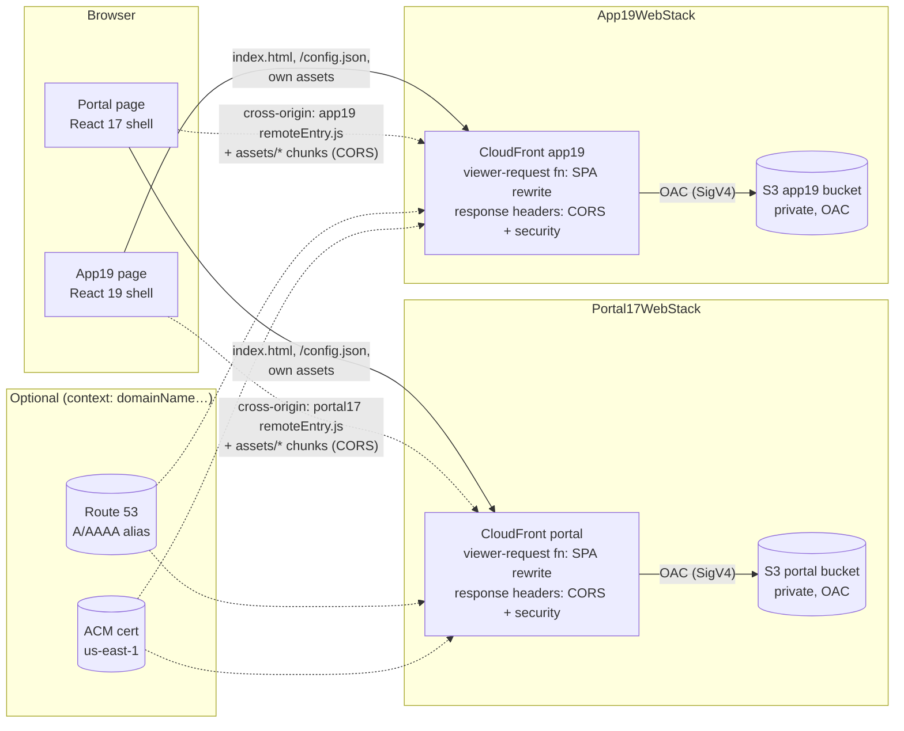
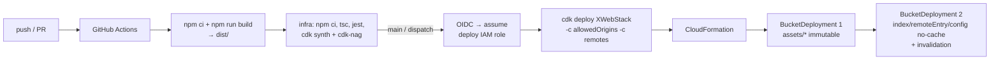

# 04 — AWS infrastructure

Implements [ADR 0003](adr/0003-aws-hosting.md) (S3 + CloudFront per app, CDK)
and the runtime remote resolution of [ADR 0002](adr/0002-remote-url-resolution.md).
Code: `react17-portal/infra/` (`Portal17WebStack`) and `react19-app/infra/`
(`App19WebStack`). Both use the same stack code (`lib/static-mfe-site-stack.ts`);
only `bin/app.ts` defaults differ. Synth-verified only — **nothing is deployed**.

## Option A (chosen): one distribution per app

Runtime flow (portal loading an R19 page):

1. Browser → `https://portal…/dashboard` → CloudFront function rewrites to
   `/index.html` (no-cache) → portal shell boots.
2. Portal fetches `/config.json` (no-cache) → `{"remotes":{"app19":"https://app…/remoteEntry.js"}}`
   → `registerRemotes`.
3. Portal imports `https://app…/remoteEntry.js` (no-cache, CORS
   `Access-Control-Allow-Origin: https://portal…`), which imports hashed
   `https://app…/assets/*.js` chunks (immutable, CORS). The R19 module mounts
   into a portal DOM node.

The reverse direction (app19 embedding portal17) is symmetrical.

### Caching

| Path | Object `Cache-Control` | CloudFront behaviour |
|---|---|---|
| `/assets/*` (hashed) | `public,max-age=31536000,immutable` | default; policy MinTTL 0 / max 1y (honours object header) |
| `/index.html`, `/remoteEntry.js`, `/config.json`, `/mf-manifest.json` | `no-cache` | dedicated behaviours, `CachingDisabled` |
| SPA routes (`/dashboard`) | rewritten to `/index.html` | default behaviour; MinTTL 0 so `no-cache` wins |
| other root files (`favicon.svg`…) | `no-cache` | default |

No 403/404 → `index.html` error responses: a missing chunk must be a real
error, not HTML served as JavaScript.

### CI/CD flow

Each repo deploys independently. Example workflow:
`infra/github-actions-deploy.example.yml` (OIDC, no static keys). Per-env
values (`ALLOWED_ORIGINS`, `REMOTES`) live in GitHub environment variables.

**First-time order:** deploy both stacks → read each `RemoteEntryUrl` output →
redeploy each with `allowedOrigins` = other origin and `remotes` = other
`RemoteEntryUrl` (only `config.json` + headers policy change). With custom
domains known up front, one pass is enough.

**Release safety:** old hashed chunks are never pruned, and the no-cache
deployment depends on the assets deployment, so a new `remoteEntry.js` never
references chunks that are not uploaded yet, and pages already running the old
`remoteEntry.js` (in either app) can still load their chunks.

## Option B: single distribution, path-based routing

One CloudFront distribution (e.g. `https://www.example.com`):
`/*` → portal bucket, `/app19/*` → app19 bucket (app19 built with
`base: '/app19/'`). Remotes are same-origin: `/app19/remoteEntry.js`.

| Pros | Cons |
|---|---|
| Same origin → no CORS, no preflight concerns, simpler CSP (`script-src 'self'`) | Couples two repos to one distribution/stack: who owns it? Behaviour changes need cross-team coordination |
| One TLS cert, one DNS name, one WAF | Each deploy must invalidate in a shared distribution; a bad cache/behaviour change breaks both apps |
| Shared cookies/storage origin (if ever needed) | app19 must be built with a path prefix; standalone app19 URL changes |
| Slightly cheaper (one distribution, fewer DNS records) | SPA rewrite function must know both apps' prefixes (`/app19/foo` → `/app19/index.html`) |
| | Shared origin also means no browser isolation between teams' code (same-origin storage, cookies) |

Choose B when both apps are owned by one team or a platform team owns the
edge; otherwise A keeps repos independently deployable (the main brief goal).
Migration A → B is mostly config: `config.json` remotes point at the path.

## Rough cost (per environment, us-east-1 pricing, verify with AWS pricing)

| Item | Demo / low traffic | ~1M page views/month (~1.5 MB each, ~1.5 TB) |
|---|---|---|
| CloudFront data transfer | Free tier (1 TB + 10M req/month always-free) | ~0.5 TB over free tier × ~$0.085/GB ≈ $45 |
| CloudFront requests | free tier | ~30M req × $0.0075–0.01/10k ≈ $20 (minus free 10M) |
| CloudFront Functions | 2M free/month | ~2M × $0.10/1M ≈ $0.2 |
| S3 storage + GETs | < $0.10 (few MB; CloudFront caches) | < $1 |
| Lambda (BucketDeployment, per deploy) | cents | cents |
| Route 53 hosted zone (optional) | $0.50/zone + queries | $0.50 + ~$0.40 |
| ACM public cert | free | free |
| WAF (optional) | ~$5/WebACL + $1/rule + $0.60/1M req | ~$10–15 |

Two apps ≈ 2× the per-app row (cross-app loads count against the remote's
distribution). Demo: effectively **$0–2/month**.

## Security notes

- Buckets are private (Block Public Access, `enforceSSL`, SSE-S3); only the
  distribution can read via **OAC** (bucket policy scoped to the distribution
  ARN). No S3 website endpoint.
- CORS is an allow-list (`allowedOrigins`), not `*`; credentials not allowed.
  CORS is not access control (files are public via CloudFront anyway) — it only
  lets the other origin execute our modules.
- Response headers: HSTS (2 years, includeSubdomains), `nosniff`,
  `strict-origin-when-cross-origin`, `X-Frame-Options: SAMEORIGIN`.
- **CSP not set yet**: it must include the other app's origin in `script-src`
  (and `connect-src` for `config.json`/manifest fetches). Start with
  `Content-Security-Policy-Report-Only` once domains are stable.
- Remote code runs with full privileges in the host page (same JS realm).
  Only load remotes from origins you control; `config.json` is the trust root,
  so protect who can deploy it (OIDC role scoped to repo + environment).
- TLSv1.2_2021 is enforced only with a custom domain/ACM cert; the default
  `*.cloudfront.net` certificate has a fixed policy.
- cdk-nag `AwsSolutionsChecks` runs on every synth; acknowledged findings with
  reasons: S1 (no S3 access logs), CFR1 (no geo restriction), CFR2 (no WAF),
  CFR3 (no CloudFront logs), CFR4 (default cert), IAM4/IAM5/L1 on CDK-managed
  BucketDeployment / AutoDelete Lambdas. Revisit S1/CFR2/CFR3 for prod.
- Buckets are `RETAIN` by default; `-c destroyOnRemoval=true` for dev only.

## Checklist

- [ ] AWS account/region chosen; `cdk bootstrap` run once by an operator.
- [ ] GitHub OIDC provider + deploy role per repo (trust: repo + environment).
- [ ] App `npm run build` produces `dist/index.html`, `dist/remoteEntry.js`,
      `dist/assets/*` (hashed) and optionally `dist/config.json`.
- [ ] First deploy of both stacks; capture `RemoteEntryUrl` outputs.
- [ ] Set `ALLOWED_ORIGINS` / `REMOTES` per environment; redeploy both.
- [ ] Verify: `curl -I -H 'Origin: https://<other>' https://<this>/remoteEntry.js`
      shows `Access-Control-Allow-Origin` and `Cache-Control: no-cache`;
      `assets/*.js` shows `immutable`; `/dashboard` returns index.html;
      `/assets/missing.js` returns 403/404 (not HTML).
- [ ] Run each repo's Playwright e2e against the CloudFront URLs.
- [ ] Optional: custom domains (ACM us-east-1 cert + `domainName`,
      `hostedZoneName`, `hostedZoneId`, `certificateArn`).
- [ ] Prod hardening: CSP (report-only first), WAF, CloudFront/S3 logging,
      alarms on 4xx/5xx rate, bucket versioning if rollback by object is wanted.
